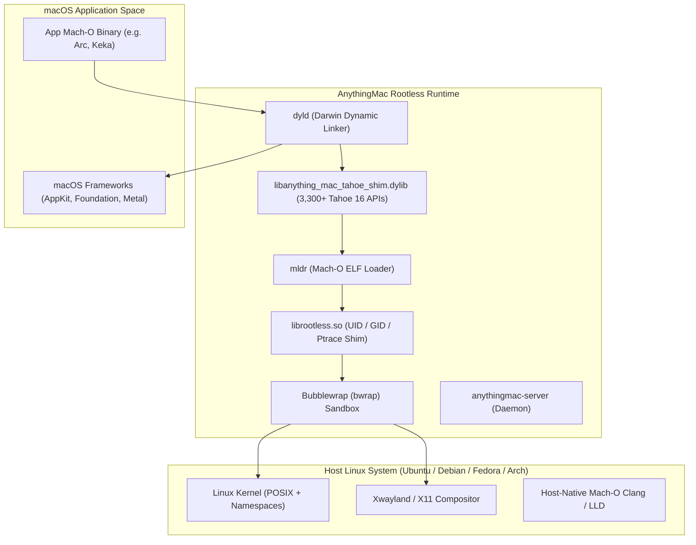

# AnythingMac 🍏🐧

> **Run modern macOS applications natively, seamlessly, and rootlessly on Linux.**

[](LICENSE)
[](#)
[](#)
[](#)

---

## 🌟 Overview

**AnythingMac** is a modern macOS compatibility runtime designed for Linux. Built from the ground up to overcome the limitations of legacy emulation projects, AnythingMac brings modern **macOS 13 (Ventura), 14 (Sonoma), 15 (Sequoia), and 16 (Tahoe)** applications to Linux desktops.

By adopting the **Hackintosh Philosophy**—feeding real Mach-O dynamic environments, dynamic Objective-C runtime synthesis, and host-native compilation rather than waiting decades for every framework to be rewritten from scratch—AnythingMac enables apps like modern Chromium browsers (Arc Browser), archive tools (Keka), and developer utilities to execute natively on your Linux CPU.

---

## 🚀 Key Innovations

### 1. 🛡️ 100% Rootless Container Architecture
- **Zero Sudo / Zero Kernel Modules:** Runs entirely in userspace using Bubblewrap (`bwrap`) containerization coupled with our custom `librootless.so` dynamic shim.
- **No `darling-mach` DKMS required:** Emulates Mach ports and task structures deterministically without compromising host kernel security.
- **Isolated User Session:** Emulated container processes run inside a private `/run/user/0` jail, ensuring that buggy macOS clients or crashes never freeze the host GNOME Wayland compositor.

### 2. ⚡ Tahoe 16 Unified Compatibility Shim
- **3,300+ Modern macOS Symbols:** Automated dynamic shim (`libanything_mac_tahoe_shim.dylib`) resolving missing symbols across CoreGraphics, Metal, Accelerate, CloudKit, ScreenCaptureKit, and Swift runtime.
- **Dynamic Objective-C Runtime Synthesis:** Implements `+resolveInstanceMethod:` and `+resolveClassMethod:` dispatchers so missing classes and selector invocations resolve safely without aborting.
- **Two-Level & Flat Namespace Harmony:** Leverages `DYLD_FORCE_FLAT_NAMESPACE=1` and `DYLD_INSERT_LIBRARIES` to inject compatibility symbols system-wide.

### 3. 🛠️ Host-Native Mach-O Darwin Toolchain
- Includes native Linux wrappers (`macho-clang`, `ld64`) backed by LLVM 18, capable of compiling and linking genuine universal Mach-O 64-bit `.dylib` and `.o` libraries directly on Linux with zero macOS dependency.

### 4. 🖥️ AnythingMac Manager (Desktop GUI)
- Modern graphical interface to:
  - Install `.dmg`, `.pkg`, and `.app` bundles with automatic extraction.
  - Automatically generate `.desktop` entries with high-resolution 512x512 app icons integrated into the GNOME/KDE application grid.
  - Control container lifecycle (Start, Stop, Shell, Restart).
  - Manage isolated prefix environments (`~/.anything-mac`).

---

## 🏗️ Architecture



---

## 💻 CLI Usage

AnythingMac provides both full-length commands and a quick 4-letter shortcut (`amac`):

```bash
# Launch an interactive Darwin Zsh shell
anything-mac shell
# or
amac shell

# Launch an installed macOS application
anything-mac launch /Applications/Keka.app
# or
amac launch /Applications/Arc.app

# Check container status
amac status

# Gracefully shut down the container
amac shutdown

# Open the AnythingMac GUI Manager
anything-mac-manager
# or
amac-manager
```

---

## 📦 File Locations & Prefixes

| Component | Default Path |
|---|---|
| **Prefix Container** | `~/.anything-mac` (fallback to `~/.darling`) |
| **Runtime Binaries** | `~/.local/anything-mac` (fallback to `~/.local/darling`) |
| **CLI Launchers** | `~/.local/bin/anything-mac`, `~/.local/bin/amac` |
| **GUI Manager** | `~/.local/share/anything-mac-manager/` |
| **Tahoe Shim** | `/usr/lib/libanything_mac_tahoe_shim.dylib` |

---

## 🛠️ Building & Customizing

### Prerequisites
- Clang 14+ / GCC 11+
- CMake 3.16+
- Python 3.10+
- Bubblewrap (`bwrap`)

### Building from Source
```bash
git clone https://github.com/your-username/anything-mac.git
cd anything-mac
mkdir build && cd build
cmake .. -DCMAKE_INSTALL_PREFIX=$HOME/.local/anything-mac
make -j$(nproc)
make install
```

---

## 📄 License

AnythingMac is distributed under the terms of the **GNU General Public License v3 (GPL-3.0)** or later. See [LICENSE](LICENSE) for details.
