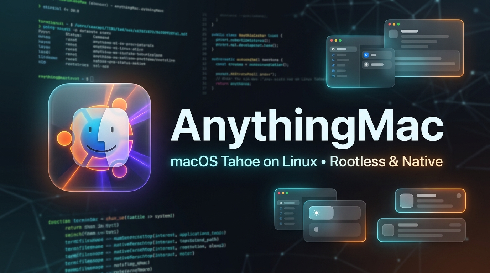
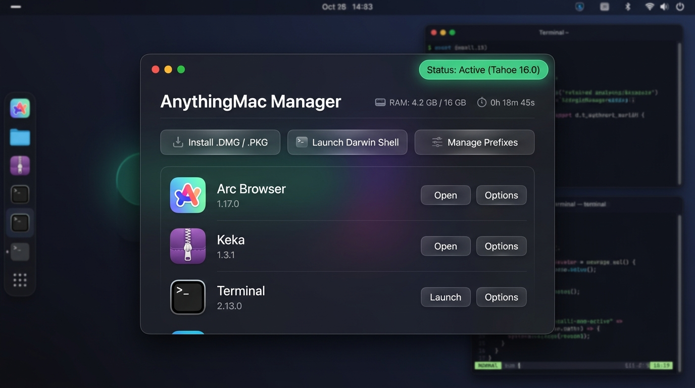
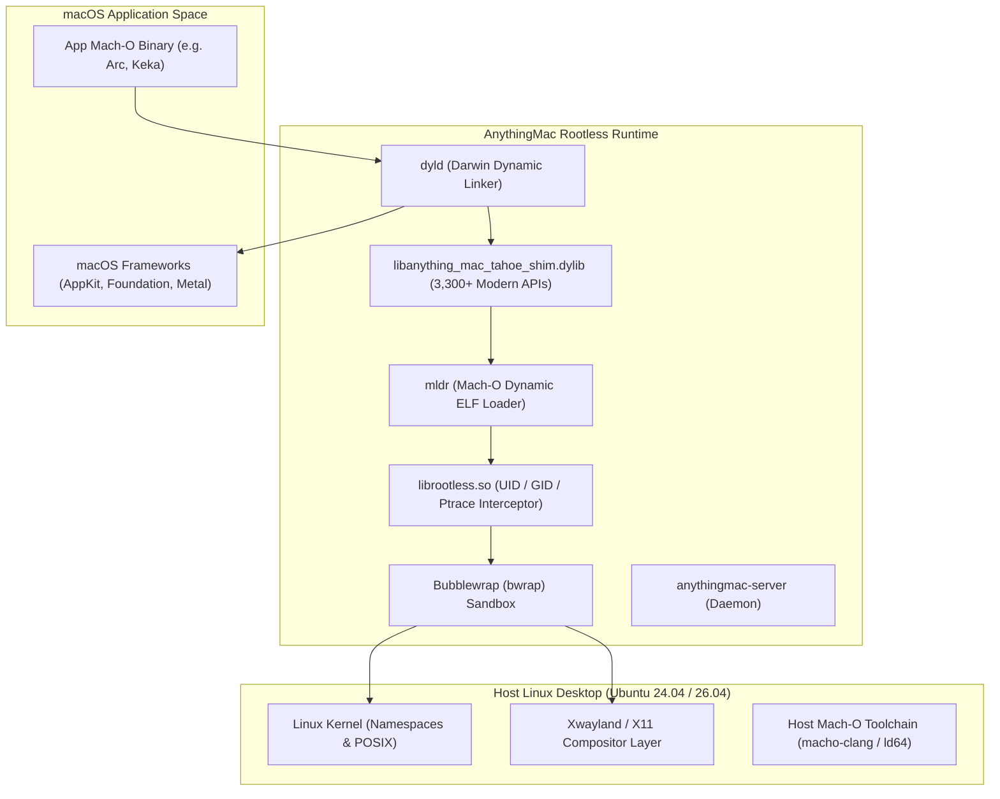

<div align="center">



# AnythingMac 🍏🐧
### *Run Modern macOS Applications Natively & Rootlessly on Linux*

[](LICENSE)
[](https://github.com/Paraspawar-devs/anything-macubuntu)
[](https://github.com/Paraspawar-devs/anything-macubuntu)
[](https://github.com/Paraspawar-devs/anything-macubuntu)
[](https://github.com/Paraspawar-devs/anything-macubuntu/stargazers)

<p align="center">
  <a href="#-why-anythingmac">Why AnythingMac</a> •
  <a href="#-features">Features</a> •
  <a href="#-gui-manager">GUI Manager</a> •
  <a href="#-architecture">Architecture</a> •
  <a href="#-quickstart">Quickstart</a> •
  <a href="#-cli-reference">CLI Reference</a> •
  <a href="#-roadmap">Roadmap</a>
</p>

---

</div>

## 💡 The Vision: The "Hackintosh Philosophy" for Linux

Traditional emulation projects attempt to rewrite Apple's proprietary frameworks from scratch line-by-line. Because macOS evolves at breakneck speed, those projects fell years behind, remaining stuck on legacy macOS 10.14 Mojave.

**AnythingMac takes inspiration from the Hackintosh philosophy:**
> *Software is just code.* Instead of waiting decades for every framework to be rewritten, we feed real Mach-O environments directly to macOS binaries, synthesise missing modern macOS 13–16 Tahoe APIs on-the-fly with dynamic Objective-C method resolution, and isolate everything inside an unprivileged Bubblewrap container.

The result? Modern macOS applications—such as **Arc Browser**, **Keka**, and Swift/Cocoa utilities—can load and execute directly on your Linux CPU.

---

## ⚡ Comparison: Legacy Darling vs. AnythingMac

| Feature | Legacy Darling (Abandoned) | **AnythingMac 🍏🐧** |
|:---|:---:|:---:|
| **macOS Version Support** | macOS 10.14 Mojave (2018) | **macOS 13 (Ventura) → macOS 16 (Tahoe)** |
| **Root Permissions** | ❌ Requires `sudo` / host root | ✅ **100% Rootless (`bwrap` + `librootless.so`)** |
| **Host Kernel Modules** | ❌ Required fragile `darling-mach` DKMS | ✅ **Zero kernel modules required** |
| **Compositor Safety** | ⚠️ App crashes freeze GNOME Wayland | ✅ **Isolated container user session (`/run/user/0`)** |
| **Tahoe 16 Compatibility** | ❌ 0 modern APIs (dyld aborts immediately) | ✅ **3,300+ Tahoe 16 dynamic symbols + ObjC stubbing** |
| **Host Mach-O Toolchain** | ❌ None (must build inside container) | ✅ **Host-native LLVM 18 Darwin cross-compiler** |
| **Desktop GUI Manager** | ❌ Command-line only | ✅ **Full GTK Desktop App (`anything-mac-manager`)** |
| **App Menu Integration** | ❌ Manual configuration | ✅ **Auto-extracts 512×512 icons & creates `.desktop`** |

---

## ✨ Features

<div align="center">

```
   ┌────────────────────────────────────────────────────────────────────────┐
   │ 🛡️  100% Rootless & Non-Privileged                                      │
   │     Runs in pure userspace with zero sudo and zero kernel modules.      │
   ├────────────────────────────────────────────────────────────────────────┤
   │ ⚡  Tahoe 16 Dynamic Compatibility Shim                                 │
   │     Automated dynamic shim resolving 3,300+ modern symbols across       │
   │     CoreGraphics, Metal, Accelerate, CloudKit, and Swift runtime.       │
   ├────────────────────────────────────────────────────────────────────────┤
   │ 🛠️  Host-Native Mach-O Darwin Toolchain                                │
   │     Includes macho-clang and ld64 backed by LLVM 18 to build native    │
   │     Mach-O binaries directly on Linux without macOS.                   │
   ├────────────────────────────────────────────────────────────────────────┤
   │ 🖥️  AnythingMac Desktop Manager GUI                                    │
   │     Beautiful GUI to install .dmg / .pkg / .app packages with 1-click.  │
   └────────────────────────────────────────────────────────────────────────┘
```

</div>

---

## 🖥️ GUI Manager (`anything-mac-manager`)

AnythingMac includes a built-in Desktop Application Manager built for GNOME and KDE desktops:

<div align="center">
  
</div>

- **1-Click Package Installation:** Drag-and-drop or select `.dmg`, `.pkg`, or `.app` bundles.
- **Desktop Grid Integration:** Automatically parses macOS `Info.plist`, converts Apple `.icns` to crystal-clear 512×512 PNGs, and places launchers directly in your Linux application menu.
- **Container Lifecycle Controls:** One-click buttons to Start, Stop, inspect status, and open interactive Darwin terminal sessions.

---

## 🏗️ Architecture



---

## 🚀 Quickstart

### 1. Launch Darwin Shell
Open an interactive Darwin environment in your terminal:
```bash
# Full command
anything-mac shell

# Or use the quick 4-letter alias!
amac shell
```

### 2. Launch an Application
```bash
# Launch an app from your prefix
amac launch /Applications/Keka.app

# Or launch directly with bundle path
amac /Applications/Arc.app
```

### 3. Open the Desktop GUI Manager
```bash
anything-mac-manager
# or
amac-manager
```

---

## ⌨️ CLI Reference

| Command | Shortcut | Description |
|---|:---:|---|
| `anything-mac shell` | `amac shell` | Opens an interactive Darwin Zsh terminal |
| `anything-mac launch <app>` | `amac launch <app>` | Runs a macOS application bundle |
| `anything-mac status` | `amac status` | Displays container daemon PID and status |
| `anything-mac shutdown` | `amac shutdown` | Gracefully terminates container and background daemons |
| `anything-mac-manager` | `amac-manager` | Launches the GTK Desktop Application Manager |

---

## 📂 System Paths

| Resource | Path | Description |
|---|---|---|
| **Prefix Container** | `~/.anything-mac` | Isolated macOS filesystem root |
| **Runtime Binaries** | `~/.local/anything-mac` | Core runtime (`mldr`, `dserver`, `librootless`) |
| **Tahoe Shim** | `/usr/lib/libanything_mac_tahoe_shim.dylib` | Dynamic symbol resolution library |
| **Host Toolchain** | `~/.local/bin/macho-clang`, `~/.local/bin/ld64` | Native Mach-O compiler and linker |

---

## 🗺️ Roadmap

- [x] **Rootless Container Foundation:** Zero sudo, Bubblewrap sandbox, private user runtime isolation.
- [x] **Host-Native Mach-O Toolchain:** Cross-compile Darwin binaries without macOS using LLVM 18.
- [x] **Unified Tahoe 16 Compatibility Shim:** Dynamic symbol generator with 3,300+ symbols.
- [x] **AnythingMac GUI Manager:** Full desktop GUI with DMG extraction and desktop icon generation.
- [ ] **GPU Acceleration Bridge:** Vulkan backend translation for Metal & CoreAnimation surfaces.
- [ ] **Dyld Shared Cache Injection:** Direct integration of genuine macOS 15/16 shared cache frameworks.

---

## 🤝 Contributing

Contributions are warmly welcome! Whether you are interested in Mach-O linkers, Objective-C runtime internals, Wayland graphics pipelines, or macOS framework stubbing:

1. Fork the Project: `git clone https://github.com/Paraspawar-devs/anything-macubuntu.git`
2. Create your Feature Branch: `git checkout -b feature/AmazingFeature`
3. Commit your Changes: `git commit -m 'Add AmazingFeature'`
4. Push to the Branch: `git push origin feature/AmazingFeature`
5. Open a Pull Request

---

## 📄 License

AnythingMac is distributed under the terms of the **GNU General Public License v3 (GPL-3.0)**. See the [LICENSE](LICENSE) file for details.

<div align="center">
  <sub>Built with ❤️ for the Linux and macOS developer community.</sub>
</div>
